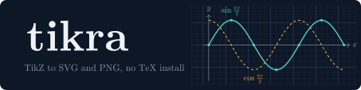

<p align="center"></p>

# tikra

tikra converts TikZ and pgfplots figures to SVG and PNG. It is a single binary and a Rust library: no TeX installation, no fonts on the system, no external processes. Math in labels is typeset by [mathra](../mathra).

```console
$ tikra figure.tex -o figure.svg
$ tikra figure.tex -o figure.png --dpi 300       # white background
$ tikra figure.tex -o figure.png --transparent
$ cat figure.tex | tikra --warnings              # SVG on stdout, warnings listed
```

```rust
let out = tikra::convert(r"\begin{tikzpicture}\draw[->] (0,0) -- (2,1) node[right] {$v$};\end{tikzpicture}")?;
std::fs::write("v.svg", &out.svg)?;
std::fs::write("v.png", tikra::png(&out.svg, 300.0, true)?)?;
for w in &out.warnings { eprintln!("{w}"); }
```

The banner above is drawn by tikra itself from [`docs/banner.tex`](docs/banner.tex).

## Input

A full `standalone` document, a bare `tikzpicture`, an inline `\tikz`, a lone `axis` environment, or loose TikZ statements. The preamble is read for `\definecolor`, `\colorlet`, `\tikzset` and `\usetikzlibrary`; the rest is ignored.

## What it draws

See [`spec/subset.md`](spec/subset.md). In short: `\draw`, `\fill`, `\filldraw`, `\path`, `\node`, `\coordinate`, `\clip`, `\foreach` (several variables, `...`, `count`), `scope` with `rotate`/`shift`/`scale`/`x=`/`y=`, `\def`, `\pgfmathsetmacro`, `declare function`, `\tikzset` and styles, `\definecolor`, xcolor mixes, positioning (`below=of A`, `right=2cm of B`, `below left=1cm and 2cm of C`), `calc` (`$(A)!0.5!(B)$`), `--`, `|-`, `-|`, `to[out=,in=]`, `bend left/right`, `.. controls ..`, `rectangle`, `circle`, `ellipse`, `arc`, `grid`, `plot` (functions and coordinates, `smooth`), polar coordinates, nodes (`rectangle`, `circle`, `ellipse`, `diamond`) with `text width`, `align`, `minimum size`, `rounded corners`, anchors, `label`, nodes in the middle of a segment, arrow tips (`->`, `->>`, `-Latex`, `-Stealth`, `|`, `o`), dashes, line widths, opacity, hatching (`pattern=…`), the `zigzag`, `snake` and `random steps` decorations, and pgfplots basics (`axis`, `\addplot` of an expression or of coordinates, `only marks`, legend, axis labels, title).

Labels: node text is typeset by mathra, with `$…$` and `\(…\)` for math, `\textbf`, `\\` for line breaks and `\small`…`\Huge`. Labels on a path inherit the path's color. Math follows mathra's default locale (English).

## Warnings, not errors

What tikra does not understand becomes a **warning**, and the figure is drawn with the rest: `\matrix`, `\pic`, unknown commands and options it cannot read, TikZ escaped twice or for Markdown (undone), labels with broken LaTeX (recovered by mathra's tolerant mode). `--warnings` lists them; `Output::warnings` has them in the library.

Limits protect against hostile input: 100,000 statements per figure, 64 levels of nesting, 2,000 samples per plot, coordinates within ±100,000 cm, PNG up to 100 megapixels. Past a limit you get a clear error or a warning, never a hang.

## Benchmark

[`corpus/`](corpus) holds 25 hand-made figures that cover the features above. Reproduce with:

```console
$ cargo run --release -p tikra --example bench
```

One run on an Apple M5 (arm64), 15 runs per figure, median per figure:

| Figures | Without warnings | With warnings | Errors |
|---:|---:|---:|---:|
| 25 | 25 | 0 | 0 |

| Per figure | Mean | p95 |
|---|---:|---:|
| SVG | 0.10 ms | 0.22 ms |
| SVG + PNG at 300 dpi | 1.72 ms | 4.98 ms |

`tests/corpus.rs` checks on every `cargo test` that all corpus figures convert without warnings.

## Development

```console
$ cargo test                                  # every test
$ cargo llvm-cov --workspace --summary-only   # coverage (100% of lines)
$ cargo clippy --all-targets -- -D warnings
```

What each test file covers and the inputs built to break the interpreter are in [docs/tests.md](docs/tests.md).

tikra depends on mathra by local path (`../mathra/crates/core`): the two repositories sit side by side.

## Licenses

Code: MIT or Apache-2.0. The font comes from mathra (STIX Two Math, SIL OFL 1.1).
